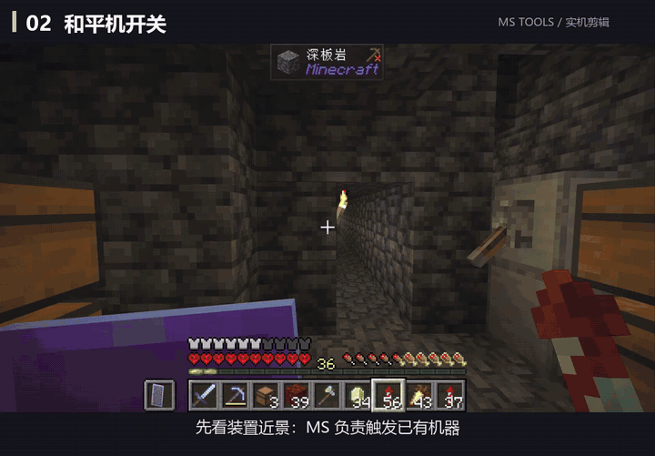
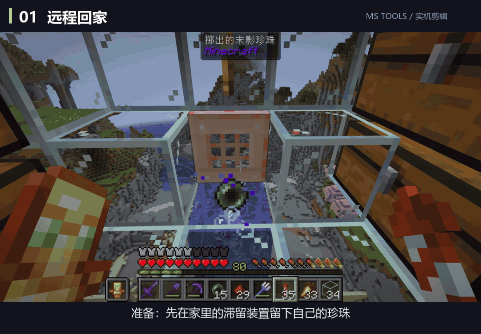
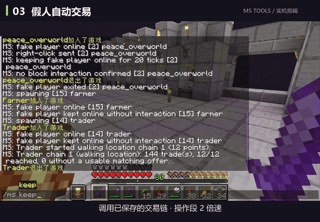
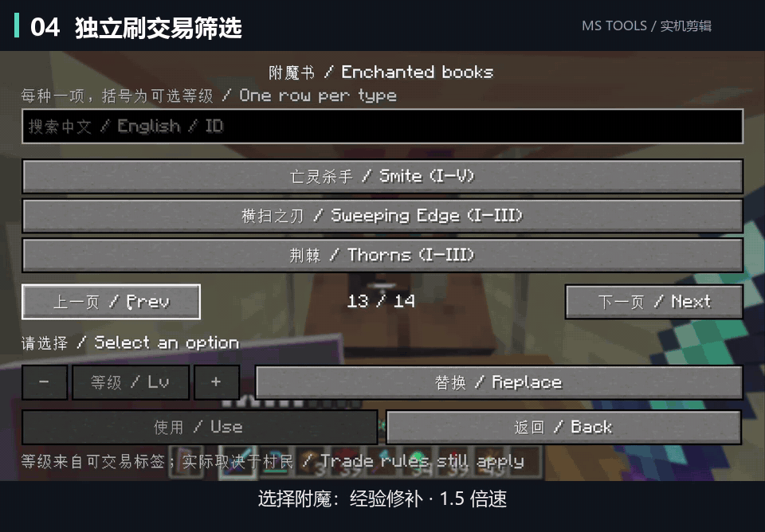

# Smarter Fake Players · MS Tools · Put your Carpet bots to work

[简体中文](README.md) · English

**Operate your machines, haul supplies and run villager trade chains in your technical survival world.**

For **Minecraft Java Edition 26.2 / 26.3, Fabric, Java 25 and Fabric Loader ≥ 0.19.3**. Other Minecraft versions have not been verified.

The current release supports Fabric only. If a Forge port is completed and tested, it will be clearly listed and published on GitHub.

[Download](https://github.com/MIHUKUAKU/ms-tools/releases/latest) · [Installation](docs/installation.en.md) · [Command reference (Chinese)](docs/全部命令.md) · [Report an issue](https://github.com/MIHUKUAKU/ms-tools/issues)

I started this because I wanted a short command to operate my mob switch without retyping a bot's name, position and rotation. It grew into helpers for moving supplies, packing shulker boxes, crafting and villager trading.

## Easier setup for your survival save

[Download the Windows setup ZIP](https://github.com/MIHUKUAKU/ms-tools/releases/latest), extract it, and run `开始安装.cmd`. Select your save folder containing `level.dat`, review the plan, and install. The installer detects an existing Fabric26.2/26.3 instance, reuses suitable installed dependencies, fills in missing files, and enables the Carpet scripts for that save. Use `安装含交易筛选.cmd` to also install the separate, singleplayer-only Trade Target filter. Java25 and a working Fabric installation are required; exit Minecraft before installing. See [installation](docs/installation.en.md) and [third-party sources](installer/前置来源与许可.txt).

v1.7.5 fixes dependency verification stopping under Windows PowerShell 5.1. All three CMD entry points and save-permission setup passed on a Windows Server 2025 test machine using disposable save fixtures; this did not include launching Minecraft.

Updates appear first on [GitHub Releases](https://github.com/MIHUKUAKU/ms-tools/releases/latest). Less frequently used forum threads may follow1–7days later. Questions and bug reports are welcome.

## Two independent parts

| Part | What it does | Requirements |
| --- | --- | --- |
| **MS** | `/ms` commands for Carpet fake players: saved positions, machine controls, item hauling and purchases from existing villager offers | Version-matched Carpet, `mstrade`, and all four Scarpet scripts |
| **Trade Target** | A single-player villager trade reroll filter: set the item, enchantment, price and trade slots; stop when a match appears | Version-matched Fabric API, Trade Cycling ≥ 1.0.21 and Visible Traders ≥ 2.5.0 |

Install either part, or both. Trade Target stops on a matching offer and does **not** buy it automatically.

## See it in action

These are recordings from my own world. Waiting is cut and some segments are sped up; playback speeds are labeled in the footage. The GIFs have no sound, and their captions are in Chinese.

### Operate an existing mob switch

Save the bot's position and rotation, then call its numbered preset. MS makes the bot operate your existing machine; it does not change difficulty or directly remove existing mobs.



<details>
<summary>Trigger your own ender pearl stasis chamber</summary>

Leave your own pearl in a working chamber first. A saved bot preset can trigger the mechanism while you are away. This depends on the pearl and chamber, and is not a direct player teleport. Cross-dimensional returns are supported; the pearl loads its own chunk.



</details>

<details>
<summary>Let a bot buy along a saved villager trade chain</summary>

Prepare a flat route and save the trading stops. The bot's main-hand item selects what to buy; it purchases existing offers using its emeralds or emerald blocks, including those in carried shulker boxes. Trade-chain `keep` waits for restocks.



</details>

<details>
<summary>Reroll until a trade matches your conditions</summary>

The separate Trade Target mod supports items, enchantments, potion effects, price ranges and multiple trade slots. This example looks for Mending at up to 14 emeralds in slots 1 or 2. It stops on a match without purchasing.



</details>

## What MS can do

- Save bot positions and rotations. `run` right-clicks once and exits shortly afterward; `walk` right-clicks and waits briefly before exiting; `keep` stays online without clicking.
- Collect chest contents with `fetch` or scan prepared container rows with `fetchall`, then move the bot and its carried items to a player with `send`.
- Collect selected items with `collect`, including items inside accessible shulker boxes, prioritizing matching storage.
- Craft empty shulker boxes from chests and shells with `craftbox`.
- Buy existing villager offers with `trade` and saved trade chains.
- Repeat attacks or held-item use, and adjust bot movement and view direction.

The [full command reference](docs/全部命令.md) documents 22 command groups in Chinese. Automated movement expects prepared, flat routes; it is not general pathfinding.

## Get started

Choose your part and follow the [English installation guide](docs/installation.en.md). The Windows/PCL installer downloads third-party dependencies from Modrinth and backs up replaced files. Java and Fabric Loader must be installed separately.

For a first MS preset, replace these example coordinates with your own:

```text
/ms add 1 alex 100.5 70 100.5 0 0 overworld
/ms keep 1
/ms list 1
/ms run 1
```

`keep` only brings the bot online. `run` performs a right-click; aim the saved preset at the control you intend to operate. Use `walk` when the machine needs a brief delay before the bot leaves. In-game Tab completion can help enter coordinates and rotation.

## Before using it

- Trade Target currently works in **single-player only**. Use an untraded villager bound to a workstation. Empty the trade input slots and cursor, and wait for advanced trade previews to load before selecting slots.
- `/ms` access depends on the documented Carpet/Scarpet permissions. On a server, follow the administrator's rules and permission configuration.
- Prepare safe routes away from obstacles, drops and lava. `clear` immediately empties a bot's inventory. The optional special-block breaking feature directly removes blocks when enabled.
- Both supported Minecraft versions compiled successfully. 26.3 has isolated runtime and actual trade-filter testing; 26.2 is confirmed through client initialization beyond compilation. Coverage is incomplete, and macOS gameplay has not been tested. See the [test report (Chinese)](docs/测试报告.md).

## Source and feedback

Browse the [MS Java extension](ms-tools/src), [Trade Target](trade-target/src), [Scarpet scripts](scripts) and [Windows installer](installer). Build information is in [Development and compatibility (Chinese)](docs/开发与兼容.md). The project uses the [MIT license](LICENSE).

For bug reports, include your Minecraft and mod versions, the command or action, and the relevant error excerpt. Remove private information from logs; a full world upload is not needed.

I built this around my own survival-world needs with Codex assisting with development and debugging. AI also helped organize the documentation.

If these tools save you repetitive work, a Star is welcome. Downloads and use are free, with no Star requirement.

The author originally used the tools on26.2 without noticeable problems. A separate26.2 isolation check covered client initialization; neither observation establishes compatibility with every dependency version.

## Full feature list

- Pick up items from a container or sweep successive container columns; prioritize carried shulker boxes.
- Deliver collected items to yourself or a specified online player, including delivery across dimensions.
- Collect and organize by target item: use a shulker-box contents list for multiple targets, prefer same-item boxes, fill matching source boxes where possible, and carry whole boxes.
- Deposit carried items at containers or saved storage points; craft empty shulker boxes and transport the results.
- Buy existing villager offers and follow saved trade chains, using emeralds, emerald blocks and currency in carried shulker boxes.
- Keep trading during working hours, wait for restocks, log off after the daily restock purchases complete, and return the next day. Re-enable the keep task after a world/server restart.
- Trigger prepared machine switches; stay online, continuously attack, or use the held item.
- Trigger a prepared pearl stasis chamber for cross-dimensional returns. Your pearl loads its own chunk; leave a valid pearl in the chamber first.
- Create bots, inspect status, move, look, turn, stop, drop items or clear inventory; optional phantom-spawning and special-block breaking controls.
- Separate singleplayer Trade Target: filter item/enchantment/potion effect, price and trade positions, stopping on a match.

Movement uses prepared flat routes. Full commands and effects: [command reference](docs/全部命令.md).

For existing installations, run `启用已有存档.cmd` to select another save and enable bot permissions and script autoload without changing any mod JARs. The normal setup already enables both settings.
